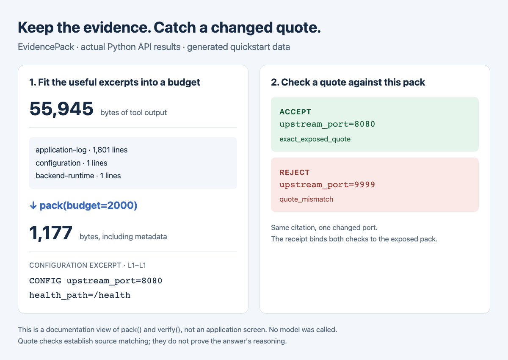

# EvidencePack

Keep the useful lines from long tool outputs, then check whether an answer quoted them correctly.

[中文](README.zh-CN.md) · [Integration](docs/integration.md) · [v0.2.1 prerelease](https://github.com/crown-sports/evidencepack/releases/tag/v0.2.1)



*Generated logs, real `pack()` and `verify()` results. No model call. [Saved output](docs/assets/readme-demo.json).*

A tool returns thousands of log lines. The useful error is in the middle, and a
model later quotes the wrong port. EvidencePack stores the original output,
selects complete excerpts within a budget, and checks quotes against the exact
pack sent to the model. It is a Python library for an agent you already have.

## Try it without a model

Python 3.11+:

```sh
git clone --branch v0.2.1 https://github.com/crown-sports/evidencepack.git
cd evidencepack
python3 -m venv .venv
source .venv/bin/activate
python -m pip install -e .
python -m examples.quickstart
python -m examples.answer_gate
```

The first example fits **55,945 bytes** of generated logs into a pack below the
**2,000-byte** allowance. `upstream_port=8080` passes; changing the port to `9999`
returns `quote_mismatch`. The second example rejects an answer when an uncited
claim is added. `python -m examples.diagnose` also runs a local HTTP fault from
**502 to 200** using a rule-based repairer.

## Add it around one tool

```python
from evidencepack import EvidenceService, Scope, SQLiteRepository

service = EvidenceService(SQLiteRepository("vault.sqlite"), Scope("local", "case-1"))
artifact = service.capture("probe", "ERROR connection refused\n")
pack = service.pack("Why did the probe fail?", [artifact.id], budget=2048)
print(pack.to_json())  # Send this payload to your model.
excerpt = pack.excerpts[0]
verdict = service.verify(pack.receipt, excerpt.citation, "connection refused")
assert verdict.valid
service.release(pack.receipt)
```

Replace the string with your tool's output. Keep the receipt in host state and
request citation IDs and exact quotes from the model. Use
`service.verify_answer(receipt, claims)` to reject the whole structured answer
if a claim is uncited or any quote fails. [Claim format and host middleware](docs/integration.md).

The CLI and optional MCP adapter use the same checks. The budget includes the
serialized evidence and its metadata; the default unit is UTF-8 bytes. Real
model tokenizers are optional. [Counters, rereads and retention](docs/product.md).

## What the checks mean

An accepted quote appeared in an unchanged excerpt from this pack. It does **not**
prove that the quote supports the model's reasoning. The host must check the full
answer and enforce rejection. Scope labels are not authentication, and the vault
must remain outside the agent's writable workspace.

In the published local fault experiment, packs averaged **1,847 bytes** from
**99,689 bytes** of input. BM25 and EvidencePack had the same aggregate model
results. [Inputs, comparisons, failures and reproduction commands](docs/results.md).

[Debug a first pack](docs/troubleshooting.md) · [Design](docs/design.md) · [Related work](docs/related-work.md) · [Contributing](CONTRIBUTING.md) · MIT license
